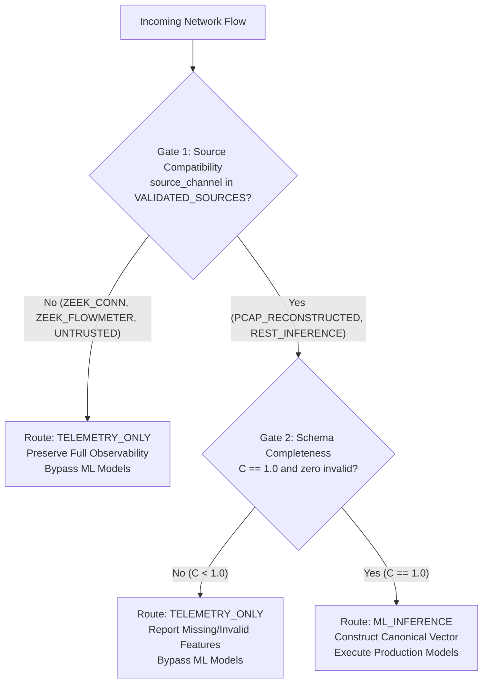

# Technical Specification: Zeek Feature-Schema Completeness Scoring and Safe Routing

## 1. Motivation & Architectural Boundary

In NetSentinel's security operations center (SOC) architecture, network observability originates from two distinct capture modalities:
1. **Packet-Level Reconstructed Flows (PCAP)**: Reconstructed with deep stateful metrics matching the Canadian Institute for Cybersecurity (CICFlowMeter) feature extraction standard.
2. **Zeek Native Telemetry (`conn.log` / Live Spool)**: High-speed connection summaries capturing flow identity (5-tuple), duration, bytes, packets, and state flags.

### The Operational Problem
Native Zeek connection logs lack 41 of the 48 statistical timing and length features required by the frozen Stage 3 machine learning models:
- `protocol_a_xgboost_k48` (Supervised attack family classifier)
- `protocol_a_isolationforest_k48` (Unsupervised statistical anomaly detector)

Feeding incomplete feature vectors or fabricating guessed/synthetic values (e.g. zero-filling inter-arrival times or window sizes) produces invalid inferences, distorts statistical anomaly scores, and generates fraudulent forensic evidence.

### The Architectural Boundary
This specification formalizes the **dual-gate boundary**:
- **Gate 1 (Source Compatibility)**: Identifies whether the data source has been verified as a semantically compatible CICFlowMeter feature provider.
- **Gate 2 (Schema Completeness)**: Formally computes the mathematical completeness ratio $C(R) \in [0.0, 1.0]$ against the frozen K=48 schema.
- Telemetry that fails either gate is routed deterministically to `TELEMETRY_ONLY`, preserving complete network visibility without invoking ML models or fabricating predictions.

---

## 2. Mathematical Definition of Feature Completeness

Let $F = (f_1, f_2, \dots, f_{48})$ be the ordered sequence of 48 canonical features from `data/metadata/selected_features.json`.

For an arbitrary input flow record $R$:

$$v(f_i, R) = \begin{cases}
1 & \text{if } f_i \in \text{keys}(R) \land \text{Valid}(f_i, R[f_i]) \\
0 & \text{otherwise}
\end{cases}$$

### Individual Feature Validity (Valid(f_i, x))
A feature value $x = R[f_i]$ satisfies $\text{Valid}(f_i, x) = 1$ if and only if all of the following rules hold:
1. **Presence**: $x \neq \text{None}$.
2. **Type Validity**: $x$ is not a boolean (`not isinstance(x, bool)`).
3. **Placeholder Rejection**: If $x$ is a string, $x \notin \{\text{""}, \text{"-"}, \text{"(empty)"}, \text{"null"}, \text{"none"}, \text{"nan"}\}$.
4. **Numeric Coercion**: $x$ can be parsed as an IEEE 754 float: $\text{val} = \text{float}(x)$.
5. **Finiteness**: $\text{math.isfinite}(\text{val})$ is True (rejects $\text{NaN}$, $+\infty$, $-\infty$).
6. **Domain Constraints**:
   - For `destination_port`: $0.0 \le \text{val} \le 65535.0$.
   - For 44 non-negative features: $\text{val} \ge 0.0$.
   - For 4 permitted signed features (`init_win_bytes_fwd`, `init_win_bytes_bwd`, `fwd_header_length`, `bwd_header_length`): signed values are accepted.

### Completeness Score Function
$$C(R) = \frac{\sum_{i=1}^{48} v(f_i, R)}{48}$$

Properties:
- $C(R) \in [0.0, 1.0]$.
- $C(R) = 1.0 \iff$ all 48 canonical features are present, finite, and valid.
- If even one feature is missing or non-finite: $C(R) \le \frac{47}{48} \approx 0.979167$.

---

## 3. Dual-Gate Safe Routing Architecture



### Trusted Source Channel Taxonomy

| Source Channel | Compatibility Status | Semantic Rationale |
| :--- | :---: | :--- |
| `PCAP_RECONSTRUCTED` | **Compatible** | Packet-level flow reconstruction calibrated and parity-validated against reference CICFlowMeter flows via `PcapParityValidator`. |
| `REST_INFERENCE` | **Compatible** | Direct authenticated REST API client supplying the validated `FlowFeaturesInput` contract. |
| `ZEEK_CONN` | **Incompatible** | Native Zeek `conn.log` / live spool; provides connection-level metadata only (lacks 41 packet-level features). |
| `ZEEK_FLOWMETER` | **Incompatible (Pending Parity)** | Contains 48 fields, but empirical statistical parity against the frozen CICIDS2017 training set has not been established. |
| `UNTRUSTED_CLIENT` | **Incompatible** | Arbitrary or client-tagged payload; untrusted claims of source compatibility are rejected. |

### Routing Decision Rule
$$\text{EligibleForML}(R, \text{source}) = \text{IsSourceCompatible}(\text{source}) \land (C(R) == 1.0)$$

$$\text{Route}(R, \text{source}) = \begin{cases}
\text{ML\_INFERENCE} & \text{if } \text{EligibleForML}(R, \text{source}) \\
\text{TELEMETRY\_ONLY} & \text{otherwise}
\end{cases}$$

---

## 4. Domain Constraint Justification Matrix

| Feature Group | Features | Permitted Range | Grounding in Existing Codebase & Data |
| :--- | :--- | :---: | :--- |
| **Port** | `destination_port` | $[0.0, 65535.0]$ | Standard 16-bit TCP/UDP port range; enforced in `FlowFeaturesInput: Field(..., ge=0, le=65535)`. |
| **Packet Lengths** | `min_packet_length`, `max_packet_length`, `packet_length_mean`, `packet_length_variance`, `fwd_packet_length_max`, `fwd_packet_length_min`, `bwd_packet_length_min`, `bwd_packet_length_mean`, `bwd_packet_length_std`, `avg_fwd_segment_size`, `min_seg_size_fwd` | $[0.0, \infty)$ | Physical packet byte counts cannot be negative; enforced in `FlowFeaturesInput: Field(..., ge=0)`. |
| **Inter-Arrival Times** | `fwd_iat_total`, `fwd_iat_mean`, `fwd_iat_std`, `fwd_iat_max`, `fwd_iat_min`, `bwd_iat_total`, `bwd_iat_mean`, `bwd_iat_std`, `bwd_iat_max`, `bwd_iat_min`, `flow_iat_mean`, `flow_iat_std`, `flow_iat_min` | $[0.0, \infty)$ | Time elapsed between packets is monotonically non-negative; enforced in `FlowFeaturesInput: Field(..., ge=0)`. |
| **Flag Counts** | `psh_flag_count`, `ack_flag_count`, `fin_flag_count`, `syn_flag_count`, `urg_flag_count`, `ece_flag_count`, `fwd_urg_flags` | $[0.0, \infty)$ | Event occurrence counts cannot be negative; enforced in `FlowFeaturesInput: Field(..., ge=0)`. |
| **Active / Idle Times** | `active_mean`, `active_std`, `active_max`, `active_min`, `idle_min`, `idle_std` | $[0.0, \infty)$ | Elapsed duration metrics are non-negative; enforced in `FlowFeaturesInput: Field(..., ge=0)`. |
| **Packet & Byte Totals** | `total_forward_packets`, `total_forward_bytes`, `act_data_pkt_fwd`, `fwd_packets_per_sec`, `bwd_packets_per_sec`, `flow_bytes_per_sec`, `down_up_ratio` | $[0.0, \infty)$ | Flow throughput and packet counts are non-negative; enforced in `FlowFeaturesInput: Field(..., ge=0)`. |
| **Initial TCP Windows** | `init_win_bytes_fwd`, `init_win_bytes_bwd` | $(-\infty, \infty)$ (supports $-1.0$) | Value is $-1.0$ when no TCP SYN window was established (UDP flows or captures starting mid-session; see `flow_state.py:108-109`). |
| **Header Lengths** | `fwd_header_length`, `bwd_header_length` | $(-\infty, \infty)$ | Unconstrained in `FlowFeaturesInput`; legacy CICFlowMeter integer overflow anomalies exist in the CICIDS2017 training set. |

---

## 5. Pseudocode

```python
def evaluate_feature_completeness(flow_data: dict) -> FeatureCompletenessReport:
    valid_count = 0
    missing = []
    invalid = {}

    for feat in CANONICAL_48_FEATURES:
        if feat not in flow_data and feat.replace("_", "-") not in flow_data:
            missing.append(feat)
            continue

        raw_val = flow_data.get(feat, flow_data.get(feat.replace("_", "-")))
        is_valid, _, reason = validate_feature_value(feat, raw_val)
        if is_valid:
            valid_count += 1
        else:
            invalid[feat] = reason

    completeness_score = valid_count / 48.0
    is_schema_complete = (valid_count == 48) and (len(invalid) == 0)

    return FeatureCompletenessReport(
        valid_features_count=valid_count,
        completeness_score=completeness_score,
        is_eligible_for_ml=is_schema_complete,
        missing_features=missing,
        invalid_features=invalid
    )

def route_flow(flow_data: dict, source_channel: TrustedSourceChannel) -> FlowRoutingResponse:
    completeness = evaluate_feature_completeness(flow_data)
    is_source_compatible = source_channel in VALIDATED_ML_COMPATIBLE_SOURCES

    if is_source_compatible and completeness.is_eligible_for_ml:
        # Construct ordered canonical feature vector
        vector = {f: float(flow_data[f]) for f in CANONICAL_48_FEATURES}
        return FlowRoutingResponse(route=ML_INFERENCE, is_eligible_for_ml=True, feature_vector=vector)

    # Telemetry-only: feature vector is explicitly None
    return FlowRoutingResponse(route=TELEMETRY_ONLY, is_eligible_for_ml=False, feature_vector=None)
```

---

## 6. Test Matrix & Empirical Fixture Results

### Quantitative Test Matrix (23/23 Passing)

| Test Category | Test Case | Condition Tested | Result |
| :--- | :--- | :--- | :---: |
| **Schema Consistency** | `test_schema_consistency_with_metadata_file` | Derived tuple matches `selected_features.json` | **PASS** |
| | `test_schema_consistency_with_flow_features_input` | Derived tuple matches `FlowFeaturesInput` | **PASS** |
| | `test_schema_consistency_with_production_models` | Derived tuple matches model metadata | **PASS** |
| **Schema Completeness** | `test_complete_48_features_from_compatible_source` | 48/48 valid features $\to C = 1.0$ | **PASS** |
| | `test_single_missing_feature_boundary` | 47/48 features $\to C = 0.9792$, missing recorded | **PASS** |
| | `test_multiple_missing_features` | 43/48 features $\to C = 0.8958$ | **PASS** |
| **Value Validation** | `test_null_value_rejected` | `None` rejected from valid count | **PASS** |
| | `test_empty_string_and_placeholder_dash_rejected` | `"-"`, `""`, `"(empty)"` rejected | **PASS** |
| | `test_non_numeric_string_rejected` | Non-numeric string fails float conversion | **PASS** |
| | `test_boolean_type_strictly_rejected` | `True` / `False` rejected as measurements | **PASS** |
| | `test_nan_value_rejected` | `float("nan")` rejected | **PASS** |
| | `test_positive_and_negative_infinity_rejected` | $\pm\infty$ rejected | **PASS** |
| **Domain Restrictions** | `test_destination_port_domain_bounds` | Rejects port $< 0$ or $> 65535$ | **PASS** |
| | `test_non_negative_metrics_reject_negative_values` | Non-negative features reject values $< 0$ | **PASS** |
| | `test_permitted_signed_features_accept_negative_values` | Accepts `init_win_bytes = -1.0`, signed headers | **PASS** |
| **Invariance & Extraneous** | `test_unexpected_keys_tracked_without_affecting_score` | Extra keys tracked, valid count stays 48 | **PASS** |
| | `test_dictionary_key_ordering_invariance` | Canonical, reversed, and shuffled key orders produce identical vector | **PASS** |
| **Dual-Gate Routing** | `test_native_zeek_conn_log_routing_to_telemetry_only` | `ZEEK_CONN` strictly routed to `TELEMETRY_ONLY` | **PASS** |
| | `test_unverified_zeek_flowmeter_routing_to_telemetry_only` | `ZEEK_FLOWMETER` routed to `TELEMETRY_ONLY` pending parity | **PASS** |
| | `test_client_source_spoofing_prevented` | Client payload source tag ignored | **PASS** |
| **Inference Isolation** | `test_telemetry_only_flows_never_reach_inference_runner` | Predictor mock is never called; zero fabricated predictions | **PASS** |
| | `test_compatible_complete_flow_calls_inference_runner` | Predictor called with validated `FlowFeaturesInput` | **PASS** |

### Empirical Fixture Evaluation (`tests/fixtures/zeek/sample_conn.json`)
The 15 real connection records from `sample_conn.json` were evaluated through the safe router:
- **Total Records Evaluated**: 15
- **Records Routed to `TELEMETRY_ONLY`**: 15 (100.0%)
- **Records Admitted to ML Inference**: 0 (0.0%)
- **Measured Completeness Scores**: $\le 0.020833$ (at most 1 / 48 features present across all records)
- **Provenance Preservation**: 100% (all 15 UIDs, IPs, ports, and timestamps preserved for SOC display)
- **ML Predictions Fabricated**: 0

---

## 7. Limitations & Operational Considerations

1. **Zeek FlowMeter Plugin Parity**:
   While `ZeekFlowMeterParser` supports 48-feature `flowmeter.log` syntax, `ZEEK_FLOWMETER` is held at `TELEMETRY_ONLY` until formal parity calibration is conducted against reference capture ground truth.
2. **Strict Non-Imputation & K=47 Fallback Policy**:
   - **Zero Silent Imputation**: NetSentinel must not fabricate, guess, or silently impute missing or invalid values (e.g., injecting mean, median, or zero for absent features is strictly prohibited).
   - **Automatic Runtime Fallback to K=47 is NOT Implemented**: Under the current Phase 1 routing policy, any incomplete K=48 flow (e.g., 47/48 features where `destination_port` is absent) fails Gate 2 and is deterministically routed to `TELEMETRY_ONLY`.
   - **Artifact Scope**: The physical existence and catalog registration of the port-ablated model artifact (`protocol_a_xgboost_k47`) does not mean automatic runtime fallback is supported. The K=47 model exists strictly as an alternative model tier that can only be invoked when explicitly specified by a caller.
   - **Future Extension**: Automatic K=47 fallback routing remains a possible future extension that requires explicit design, formal validation, and dedicated regression testing before activation.
3. **No Feature Drift Implementation in Phase 1**:
   Feature distribution drift monitoring (e.g., KS-test or PSI drift) is out of scope for Phase 1 and will be addressed in subsequent phases.
